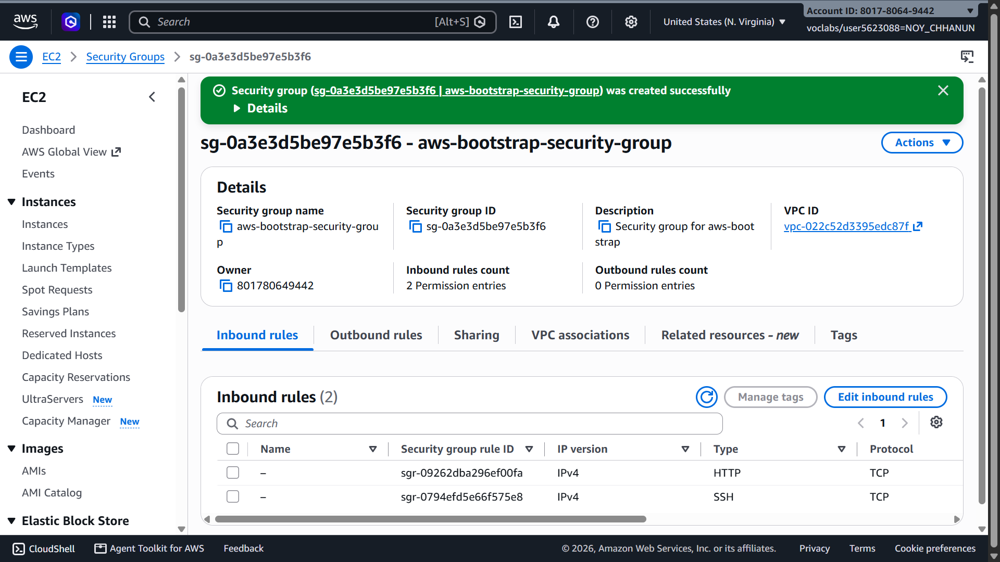
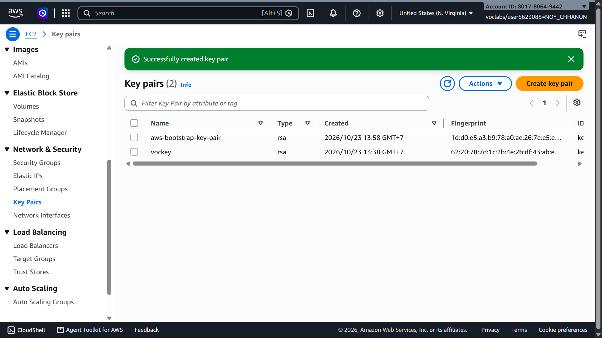
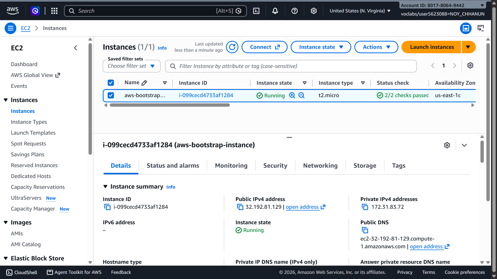
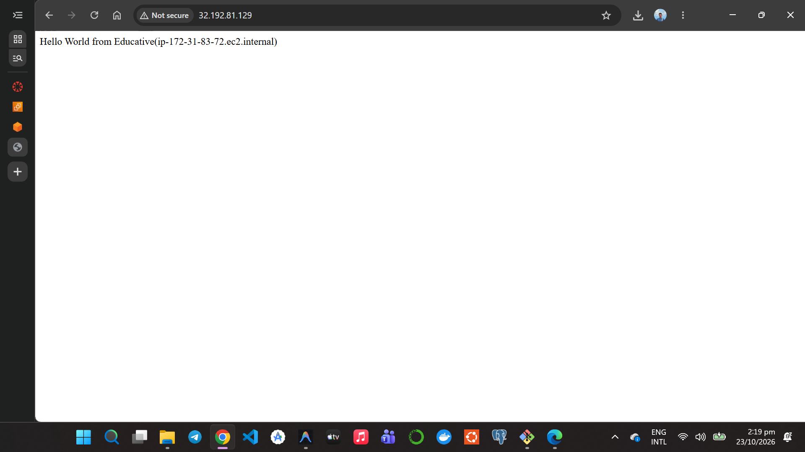
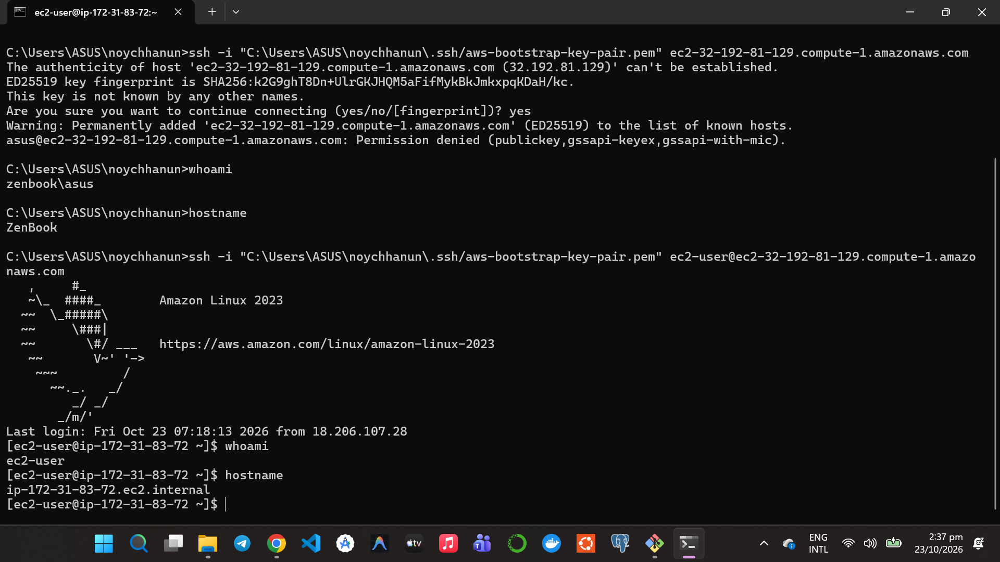
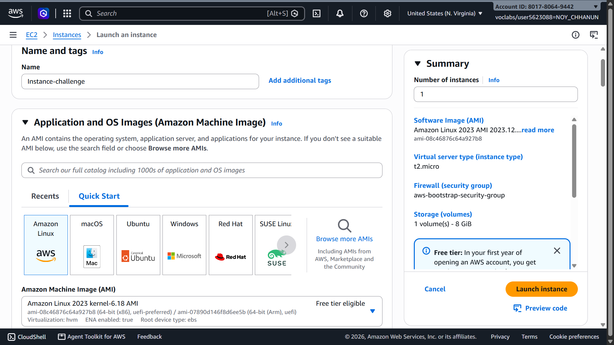
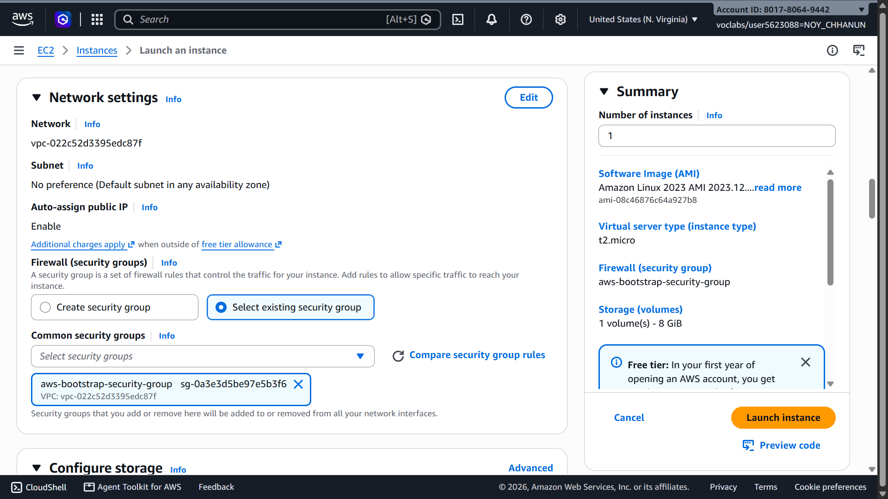
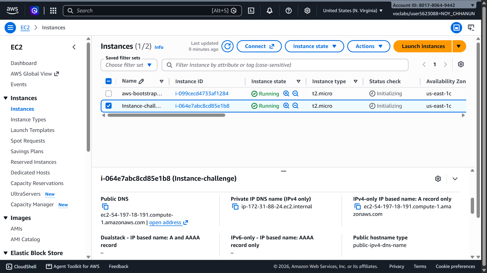
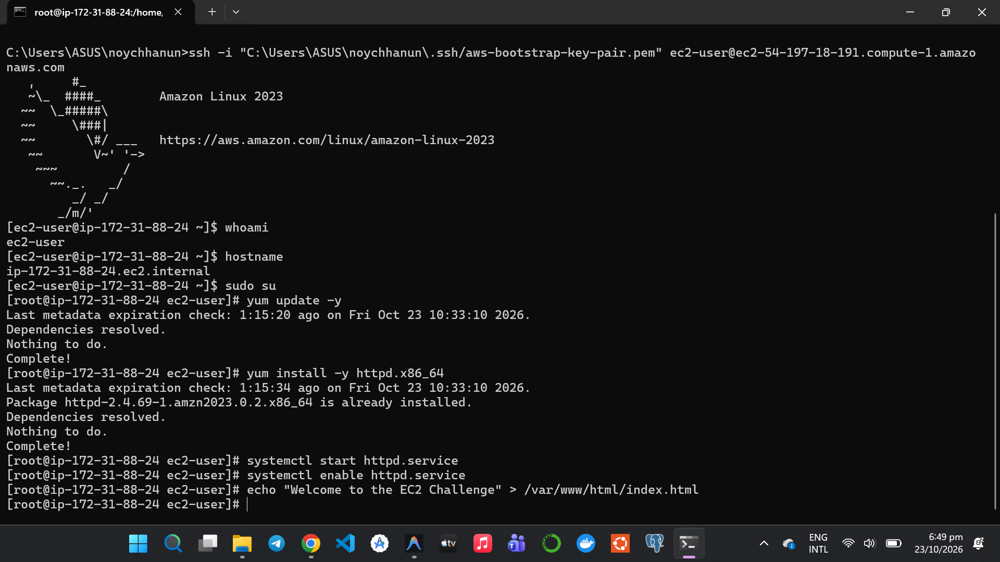
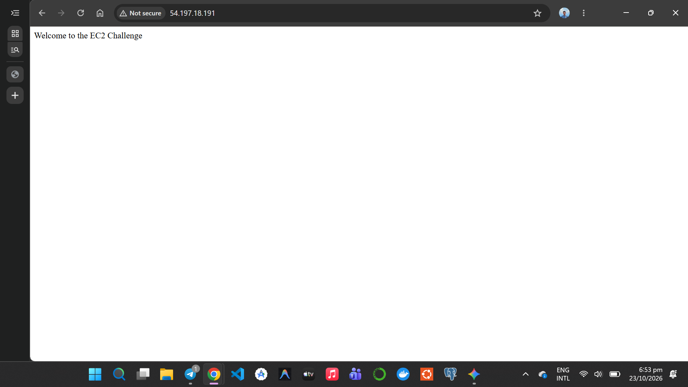

# Cloud Lab 1 Submission — Amazon EC2

Copy this template to `cc-lab-YOUR_ID/lab1/README.md` in your own repository. Follow [the instructions](lab1-instruction.md). Put your screenshots in `lab1/images/` with the file names below.

- **Student name:** NOY CHHANUN
- **Student ID:** e20220192
- **Learner Lab user name:** voclabs/user5623088=NOY_CHHANUN
- **Date completed:** October 23, 2026

---

## Part 1.1 — An Amazon EC2 Walkthrough

### Security group



### Key pair



### Instance details



### Browser test



### SSH connection



**Did you connect with your own SSH client or with EC2 Instance Connect?**

I connected with my **own SSH client** (OpenSSH via Windows Terminal) using the private key:
```bash
ssh -i "C:\Users\ASUS\noychhanun\.ssh/aws-bootstrap-key-pair.pem" ec2-user@ec2-32-192-81-129.compute-1.amazonaws.com
```

---

## Part 1.2 — EC2 Web Solution (Challenge)

### Launch configuration



### Security group



### Running instance



### Commands on the instance



Paste the commands you ran to install the web server and create `index.html`:

```bash
sudo su
yum update -y
yum install -y httpd.x86_64
systemctl start httpd.service
systemctl enable httpd.service
echo "Welcome to the EC2 Challenge" > /var/www/html/index.html
```

### Browser test



---

## Questions

1. **Your security group has an SSH rule and an HTTP rule. What does each one let you do? What would stop working if you deleted the HTTP rule?**
   - **SSH rule (port 22):** Allows inbound Secure Shell traffic, enabling remote command-line access to log into, configure, and administer the Linux EC2 instance using an SSH client and the key pair.
   - **HTTP rule (port 80):** Allows inbound web traffic from clients/browsers anywhere on the Internet (`0.0.0.0/0`) to access the Apache web server hosted on the instance.
   - **If the HTTP rule is deleted:** Users will no longer be able to load or view web pages from the instance in a web browser (the browser will hang and time out because the security group firewall drops the packets). However, SSH remote administrative access on port 22 would still work normally.

2. **In Part 1.1 you never logged in to install the web server. What installed it, and when did it run?**
   - It was installed by the **User Data script** (bootstrap script) specified under the *Advanced Details* section during instance launch.
   - The script was executed automatically by `cloud-init` with root privileges during the **initial boot cycle** (first startup) of the instance.

3. **Why does the web page open with `http://` but not with `https://`?**
   - `http://` uses unencrypted HTTP on port 80, which is allowed by the security group and has the Apache HTTP server configured and listening.
   - `https://` uses SSL/TLS encryption over port 443. It does not open because:
     1. The security group does not have an inbound rule allowing port 443 (HTTPS).
     2. The Apache web server is not configured with an SSL/TLS certificate or an HTTPS listener.

4. **Part 1.2 asked for a 10 GiB root volume. Where in the launch settings did you set it, and how can you check the size on the running instance?**
   - **In Launch Settings:** In the EC2 Launch wizard under the **"Configure storage"** section, by changing the root EBS volume size from the default 8 GiB to 10 GiB.
   - **On the Running Instance:** You can verify the volume size via the terminal using commands such as:
     - `lsblk` (lists all block storage devices, disks, and partitions along with their allocated sizes).
     - `df -h` (displays filesystem disk space usage, total capacity, and mount points like `/`).

## Problems and how I solved them (optional)
- When first connecting via SSH, the terminal prompted that the authenticity of host could not be established. I confirmed the connection by entering `yes`, successfully adding the host key to `known_hosts`.
- Stored the private `.pem` key securely in `.ssh/` and ensured appropriate file permissions so OpenSSH could authenticate properly.

## AI note (optional)

One suggestion an AI tool gave you and how you checked it.
- An AI tool suggested verifying that the Apache web server service (`httpd`) was running and enabled to automatically start upon system reboot using `sudo systemctl status httpd` and `sudo systemctl enable httpd.service`. I checked and confirmed this by running the commands directly in the terminal and verifying the active (running) status.

## Clean up

- [x] Part 1.1: instance terminated, key pair and security group deleted.
- [x] Part 1.2: instance terminated, security group (and key pair, if any) deleted.

