# Cloud Lab 2 Submission — Load Balancer and Auto Scaling

Copy this template to `cc-lab-YOUR_ID/lab2/README.md` in your own repository. Follow [the instructions](https://github.com/RathpiseyAlpha/ITC-I5GIC-CC/blob/main/labs/lab2/lab2-instruction.md). Put your screenshots in `lab2/images/` with the file names below.

- **Student name:** NOY CHHANUN
- **Student ID:** e20220192
- **Learner Lab user name:** voclabs/user5623088=NOY_CHHANUN
- **Date completed:** October 30, 2026

---

## Security groups

### Load Balancer Security Group
Allows inbound HTTP traffic on port 80 from anywhere (`0.0.0.0/0`).

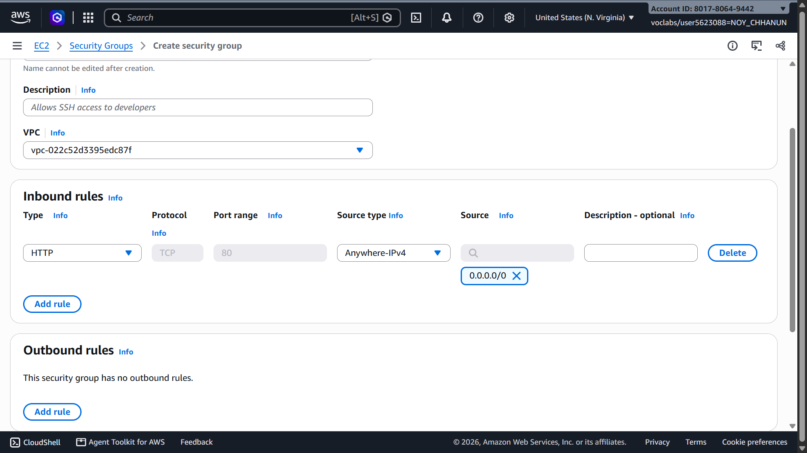

### Launch Template Security Group
Allows inbound HTTP traffic on port 80 and SSH traffic on port 22.

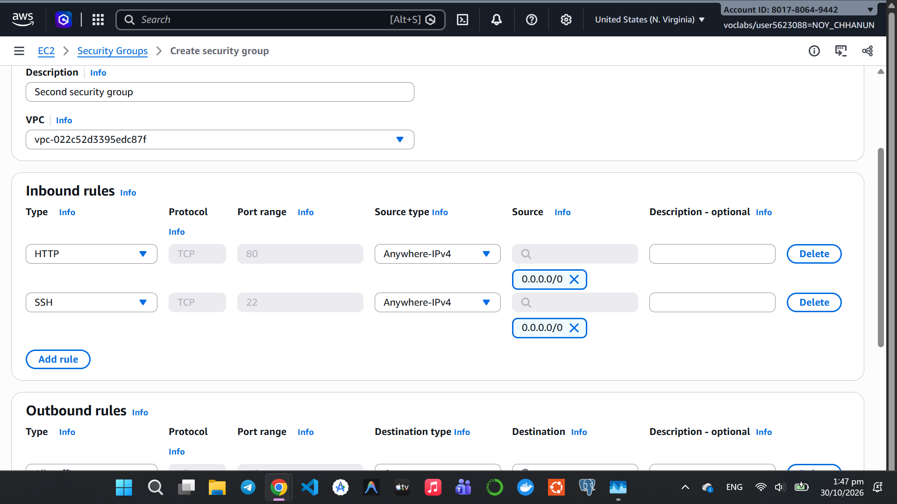

---

## Target group

Target group configured with HTTP protocol on port 80, using default health check path `/`.

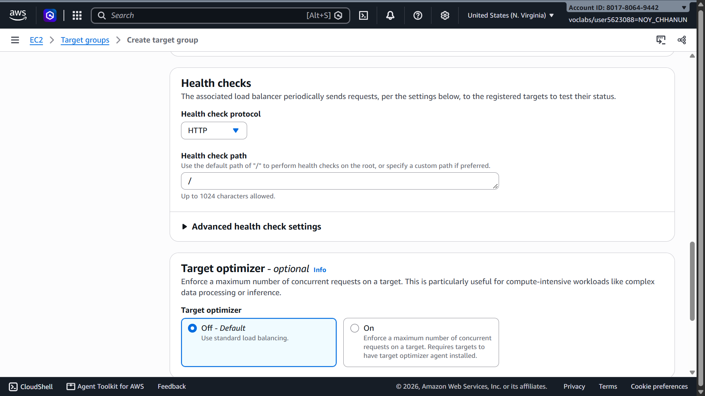

---

## Application Load Balancer

### Load Balancer Listeners and Rules
ALB listener forwarding HTTP:80 traffic to `LoadBalancerTargetGroup`.

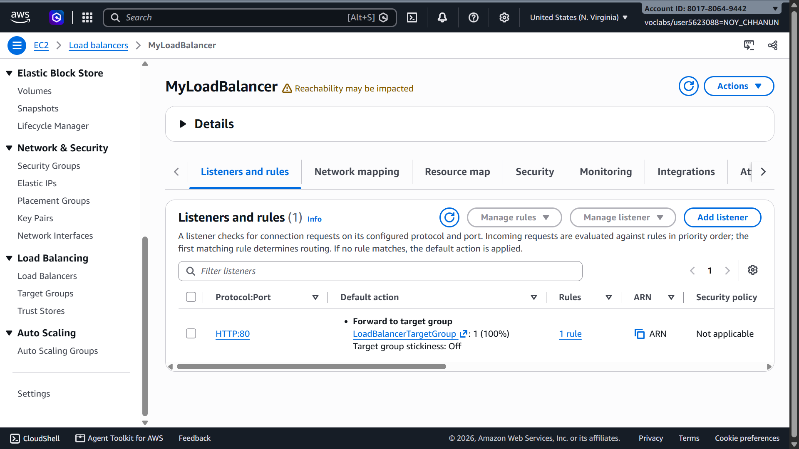

### Load Balancer Details
ALB `MyLoadBalancer` provisioned across multiple Availability Zones in the default VPC.

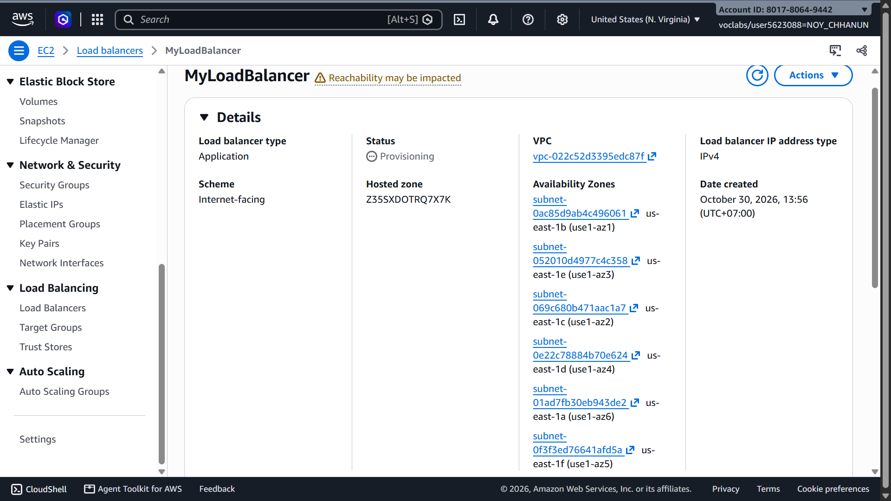

---

## Launch template

Launch template `AutoScalingLaunchTemplate` configured with Amazon Linux 2023, `t2.micro`, and web server User Data bootstrap script.

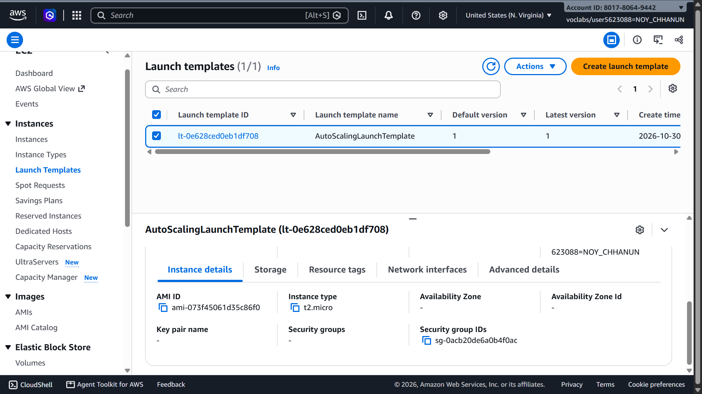

---

## Auto Scaling group

### Auto Scaling Group List
Auto Scaling group `MyAutoScalingGroup` created using `AutoScalingLaunchTemplate`.

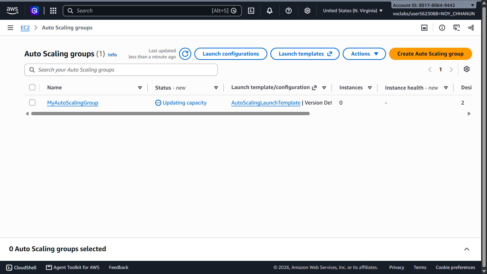

### Auto Scaling Group Details
Capacity configuration: Desired = 2, Minimum = 2, Maximum = 3.

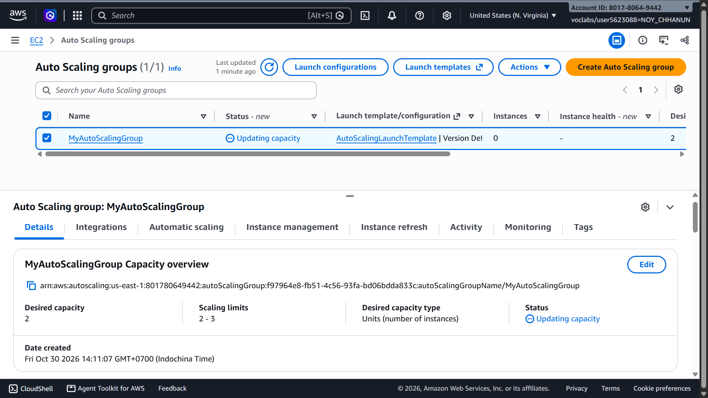

---

## Load balancing test

### Request 1
Accessing the ALB DNS URL routes to the first instance (`ip-172-31-74-241.ec2.internal`).

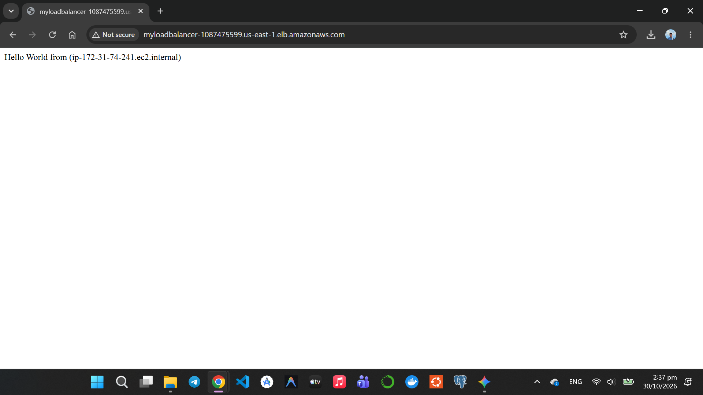

### Request 2 (After Refresh)
Refreshing the browser routes the request to the second instance (`ip-172-31-2-138.ec2.internal`).

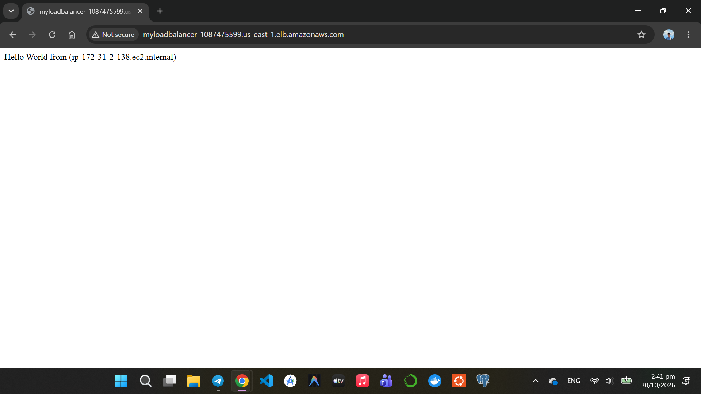

---

## Simulated application failure

### Stopping httpd on one instance
Connected to instance `i-04f9498d58db0fe2d` (Private IP: `172.31.2.138`) via EC2 Instance Connect and stopped the web server service.

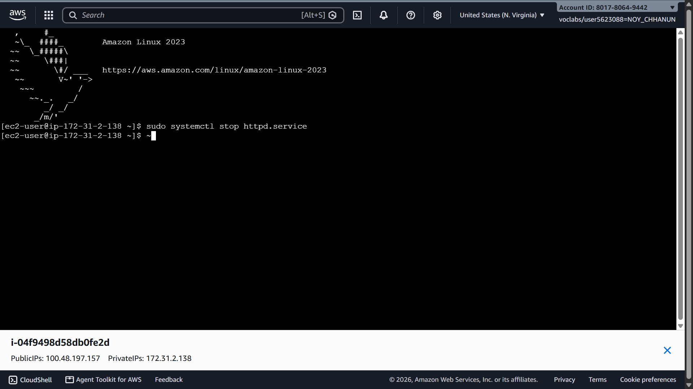

### Target group marking instance unhealthy
The target group health checks detect the failure on port 80 and mark target `i-0ea1f398fa6903fee` as `Unhealthy`.

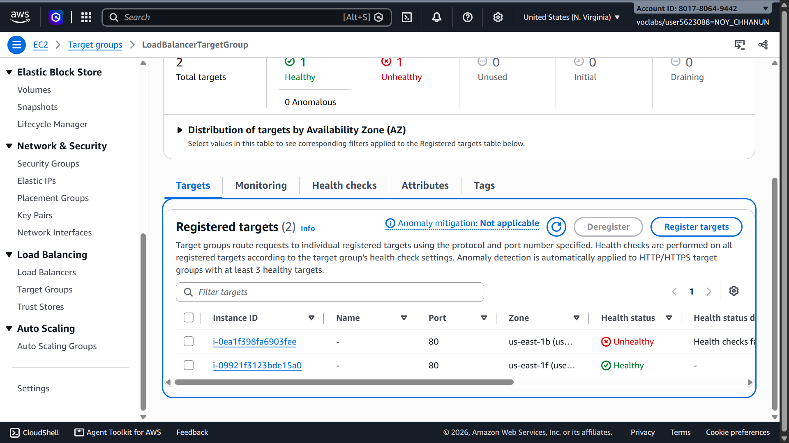

### Auto Scaling group replacing the unhealthy instance
The unhealthy target is set to `Draining` and deregistered, while the Auto Scaling group launches a replacement instance to maintain the desired capacity of 2 healthy instances.

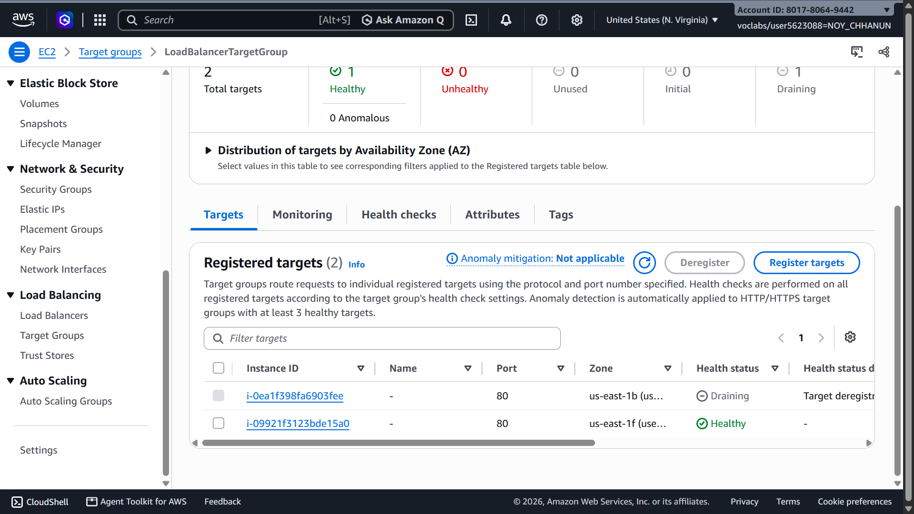

### About how many minutes passed between stopping httpd and the new instance becoming healthy?

About **2 to 3 minutes**. 
- It took approximately 1 minute (2 consecutive 30-second health check intervals) for the Target Group to detect that port 80 was no longer responding and mark the target as `Unhealthy`.
- The Auto Scaling group then initiated termination/draining of the unhealthy target and launched a new EC2 instance from the Launch Template.
- Within another 1 to 2 minutes, the new instance finished booting, executed its User Data script to start `httpd`, and passed the required consecutive health checks to become `Healthy`.

---

## Questions

### 1. Why does the page show a different host name when you refresh it?
The Application Load Balancer (ALB) balances incoming HTTP requests across all healthy targets registered in the Target Group using a round-robin routing algorithm. Since the Auto Scaling group launched multiple EC2 instances across different subnets/availability zones, each request is forwarded to a different backend instance. Because each instance's web page dynamically outputs its own private hostname (e.g., `ip-172-31-74-241.ec2.internal` vs `ip-172-31-2-138.ec2.internal`), refreshing the browser displays the hostname of whichever EC2 instance handled that specific request.

### 2. After you stopped httpd, the instance was still running in EC2, but the target group marked it unhealthy. What did the health check test, and why did the instance fail it?
- **What it tested:** The ALB Target Group performs an **application-layer (Layer 7) HTTP health check** by periodically sending an HTTP GET request to port 80 at path `/` and expecting a successful HTTP status code (HTTP 200).
- **Why it failed:** When `sudo systemctl stop httpd.service` stopped the Apache daemon, there was no longer any process listening on port 80. The health check probe received connection refused / timeouts. While the EC2 instance OS and hardware status checks were still green (since the VM was running), the instance failed the application health check and was marked `Unhealthy`.

### 3. Who replaced the failed instance: the load balancer, the target group, or the Auto Scaling group? Explain the role of each one.
The **Auto Scaling group** replaced the failed instance. The role of each component is:
- **Target Group:** Actively probes the health of instances on port 80 at path `/`. When an instance fails consecutive checks, the target group flags it as `Unhealthy` and notifies the load balancer and Auto Scaling group.
- **Application Load Balancer (ALB):** Uses target group health information to make traffic routing decisions. Once a target is marked unhealthy, the ALB stops forwarding client requests to it so end users do not encounter errors. The ALB does not manage, launch, or terminate EC2 instances.
- **Auto Scaling Group (ASG):** Monitors instance health (using ELB health checks) and enforces capacity requirements. When notified that an instance is unhealthy and capacity falls below the desired count (2), the ASG terminates the failed instance and automatically launches and registers a new EC2 instance using the Launch Template to restore the desired capacity.

### 4. With desired 2, minimum 2 and maximum 3, how many instances run normally? In what situation could there be 3?
- **Normally:** **2 instances** run during steady-state operations because Desired Capacity is set to 2 (bounded by Min 2).
- **Situations where there could be 3:**
  1. **Scaling Out under load:** If a scaling policy is attached (such as Target Tracking on CPU utilization or request count) and traffic spikes, the ASG scales up the instance count up to the Maximum capacity of 3.
  2. **Instance replacement / Refresh:** When replacing an unhealthy instance or performing an instance refresh/rolling update, the ASG may launch the replacement instance before terminating the old one, temporarily having 3 instances running simultaneously.
  3. **Manual adjustment:** An administrator manually increases the desired capacity to 3 in the AWS Management Console or CLI.

### 5. The instances' security group allows HTTP from anywhere. How could you change it so that the instances accept HTTP only from the load balancer?
In the EC2 instances' security group (`Second security group` / `AutoScalingLaunchTemplate` security group):
1. Navigate to EC2 $\rightarrow$ **Security Groups** and select the instance security group.
2. Edit **Inbound rules**.
3. For the HTTP (port 80) rule, remove `0.0.0.0/0` from the **Source** field.
4. Set the **Source** to the **Security Group ID of the Application Load Balancer** (e.g., `sg-0a3e3d5be97e5b3f6` / `sg-load-balancer`).
5. Save rules. This creates security group chaining: the instances will strictly accept HTTP requests that originate from the load balancer, blocking any direct internet traffic to the instance IPs while preserving full web functionality through the ALB.

---

## Problems and how I solved them (optional)
- **Health Check Detection Delay:** Observed that after running `sudo systemctl stop httpd.service`, the target status did not change immediately. This is expected behavior due to the health check interval (30 seconds) and the unhealthy threshold (2 consecutive failures). Waiting about 1 minute and refreshing the Target Group console confirmed the `Unhealthy` status.
- **Subnet Configuration:** Ensured that multiple subnets across different Availability Zones (AZs) were selected in both the ALB and ASG to achieve fault tolerance and high availability.

---

## AI note (optional)

One suggestion an AI tool gave you and how you checked it.
- An AI tool suggested checking the **Activity History** tab in the Auto Scaling group console to observe the exact lifecycle sequence: the ELB health check failure triggering instance deregistration and draining, followed by the launch of a new EC2 instance. I verified this by navigating to the Activity tab and inspecting the event timestamps.

---

## Clean up

- [x] MyAutoScalingGroup deleted and its instances terminated.
- [x] AutoScalingLaunchTemplate deleted.
- [x] MyLoadBalancer and LoadBalancerTargetGroup deleted.
- [x] Both security groups deleted.

